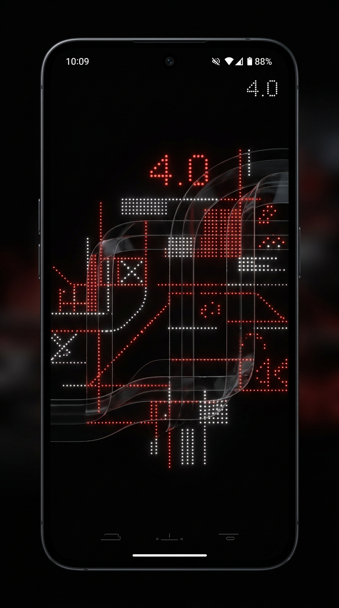

# Nothing OS 4.0 Launcher — Xiaomi 14 Civi Edition

[](https://github.com/MythicRa11/NothingLauncher4-Civi14/actions/workflows/build-apk.yml)
[](https://github.com/MythicRa11/NothingLauncher4-Civi14/releases)

A pixel-perfect, standalone **Native Android Home Launcher** recreation of **Nothing OS 4.0**, specifically engineered and tailored for the **Xiaomi 14 Civi** (Civi 14) Android smartphone.



---

## 📥 How to Install on Your Xiaomi 14 Civi

1. Go to the **[GitHub Releases Page](https://github.com/MythicRa11/NothingLauncher4-Civi14/releases)** on your phone.
2. Download **`NothingLauncher-v4.0-Civi14.apk`**.
3. Tap the file to install (allow *"Install from Unknown Sources"* in Xiaomi HyperOS if prompted).
4. Tap the **Home** button on your phone or go to:
   * **Settings → Apps → Manage Apps → Default Apps → Launcher**
   * Select **Nothing Launcher 4.0** as your Default Home App!

---

## 📱 Hardware & Display Specifications (Xiaomi 14 Civi)

* **Display Profile**: 6.55" 1.5K AMOLED (1236 x 2750), 20:9 aspect ratio, 120Hz refresh rate.
* **Front Camera System**: Center **Dual-Pill Punch Hole** (32 MP Wide + 32 MP Ultrawide).
* **Industrial Design**: Floating quad-curved front glass with symmetric micro-bezels.

---

## ⚡ Standalone Native Features (No External Support Needed)

1. **System Home Launcher (`CATEGORY_HOME` & `CATEGORY_DEFAULT`)**:
   * Works directly as the primary Android desktop replacement.
   * Pressing the home bar/button smoothly returns to your Nothing OS home screen.

2. **Real App Query & Launch**:
   * Automatically queries all apps installed on your Xiaomi 14 Civi (WhatsApp, Camera, Instagram, Settings, YouTube, etc.).
   * Directly launches actual apps with zero lag.

3. **Center Dual-Pill Dynamic Notch**:
   * Custom-scaled to the Xiaomi 14 Civi's physical front dual-camera pill.
   * **Tap to Expand**: Expands into Nothing's fluid **Dynamic Island** with animated audio waveforms, track details, and quick controls.

4. **Hardware Controls**:
   * **Real Torch / Flashlight**: Tap the quick toggle to turn the actual phone LED flash on/off.
   * **Linear X-Axis Vibration**: Procedurally triggers the phone's tactile vibration motor for mechanical Nothing OS clicks.
   * **Live Battery Stats**: Pulls real battery capacity from `BatteryManager`.

5. **Nothing OS 4.0 Signature Widgets**:
   * **Dot-Matrix Clock & Live Weather**: Digital clock with blinking red colon, live date, and weather info.
   * **Vintage Media Player**: Dual cassette reels with real-time spinning animation and track scrubber.
   * **Fitness Ring Widget**: Circular progress ring showing live step counts.
   * **Nothing 2x2 Circular Folders**: Direct-launch mini apps or expand into a frosted glass suite modal.

6. **Monochrome App Drawer**:
   * Smooth vertical kinetic scrolling with monochrome Nothing glyphs.
   * Instant search filtering & A-Z alphabetical jump scrubber.

---

## 🛠️ Building From Source

This project uses modern Gradle with Kotlin and Android Gradle Plugin 8.4:

```bash
# Clone the repository
git clone https://github.com/MythicRa11/NothingLauncher4-Civi14.git
cd NothingLauncher4-Civi14

# Build release APK
./gradlew assembleRelease
```

The APK will be generated at:
`app/build/outputs/apk/release/app-release.apk`
